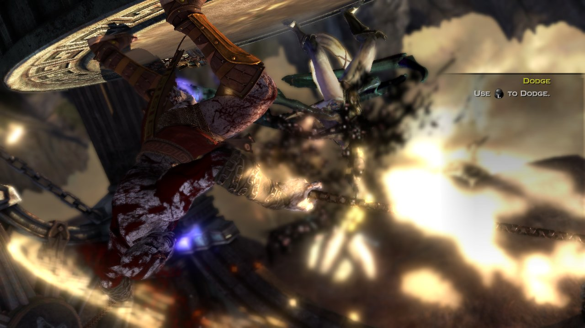
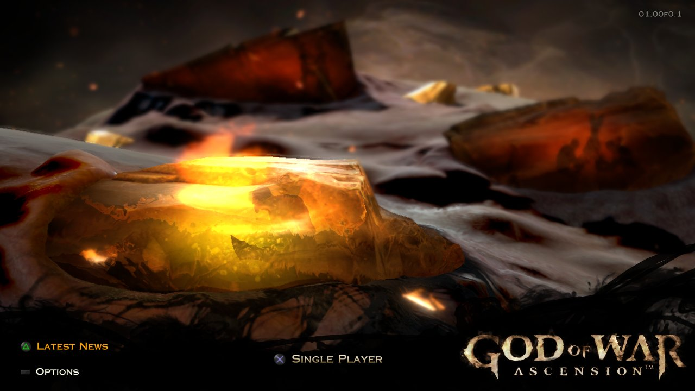
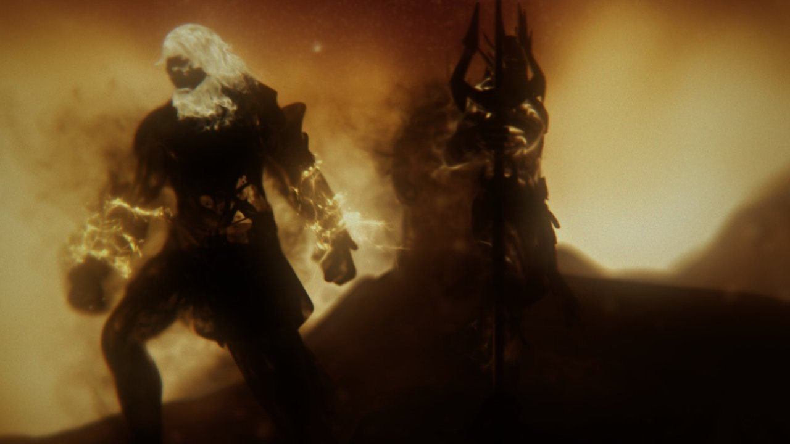

# God of War: Ascension — static recompilation (PS3)

> **Status: research / early bring-up. Not playable.** The game boots, plays its intro movies, shows the main menu
> with text and music, and runs the first level with the Vulkan backend at about 13 frames per second on a
> 6-core CPU with an RTX 3080, with no hangs in 25-minute runs. Where the time
> goes and what is being worked on is in [docs/STATUS.md](docs/STATUS.md). Generic fixes go upstream to ps3recomp
> as small PRs. Contributions are welcome: see [CONTRIBUTING.md](CONTRIBUTING.md).

An attempt to statically recompile *God of War: Ascension* (PS3, `BCUS98232`) into a native Windows executable,
built on top of the [ps3recomp](https://github.com/sp00nznet/ps3recomp) toolkit (PPU lifter, SPU lifter,
HLE runtime, Vulkan/D3D12 RSX backends).

**This repository contains no game data, no firmware and no code derived from them.** You need your own legally
acquired copy of the game and (optionally) your own PS3 firmware dump. See [docs/LEGAL.md](docs/LEGAL.md).

| Main menu (text, music) | Intro movie (MPEG-2 through cellVdec) |
|---|---|
|  |  |

Captured from the port's own Vulkan output (`PS3RECOMP_VK_DUMP`) on 2026-10-20, at 1280x720.

## What lives here

| Path | Contents |
|------|----------|
| `port/` | The game-specific port: `CMakeLists.txt`, `main.cpp` (runner), `stubs.cpp` (hooks), `lle_libsre.cpp` (optional firmware-SPURS LLE glue), `config.toml` |
| `patches/` | Patch against upstream ps3recomp (fixes and diagnostics found while bringing the game up) — meant to be upstreamed |
| `spu/images.json` | Description of the SPU images lifted for this title (policy module, SPURS kernel, ...) |
| `analysis/` | Python tools used to measure the binary (carving SPU blobs, PSARC TOC, xrefs, `findstore.py`, `make_spu_port.py`) |
| `scripts/` | Windows build helpers (`GOW_ROOT`-relative) |
| `launcher/` | Player launcher (Python/Tk): paths, setup check, play/stop with logs, save backups |
| `docs/` | Feasibility study (pt-BR), architecture notes, debugging playbook, related work, legal |
| `local/` | **Git-ignored.** Your game dump, decrypted ELF, firmware, lifted C++, toolchains, logs |

## Quick start

See [docs/BUILDING.md](docs/BUILDING.md). In short: dump your disc, decrypt `EBOOT.BIN` to an ELF, run the
ps3recomp loader/lifter on it, apply `patches/`, configure with `scripts/cfg.bat`, build with `scripts/build.bat`,
run `MyGameRecomp.exe <path>/PS3_GAME/USRDIR/EBOOT.elf`.

## Playing

Once you have a build, `scripts\launch.bat` (or `python launcher\gow_launcher.py`) opens the launcher. Point it at
your `MyGameRecomp.exe` and your `PS3_GAME/USRDIR/EBOOT.elf`, press **Check setup**, then **Play**. It keeps a log
per run in `launcher/logs/`, can skip the intro movie, and backs up / restores your saves to `launcher/backups/`.
Every option maps to a runtime environment variable shown in its tooltip; see [launcher/README.md](launcher/README.md).

## Related projects

See [docs/RELATED_PROJECTS.md](docs/RELATED_PROJECTS.md): ps3recomp and its game ports, RPCS3 (used as an oracle),
XenonRecomp / UnleashedRecomp, N64: Recompiled, and others.

## License

The original work here (`port/`, `analysis/`, `scripts/`, `spu/`, `docs/` and the changes in `patches/`) is
[MIT](LICENSE): keep the copyright notice and please link back here. It builds on
[ps3recomp](https://github.com/sp00nznet/ps3recomp) (MIT) by its authors. Game assets, firmware and anything lifted
from them are **not** covered and must never be committed.

God of War is a trademark of Sony Interactive Entertainment LLC. This is a fan research project, not affiliated with
or endorsed by Sony Interactive Entertainment or Santa Monica Studio.
